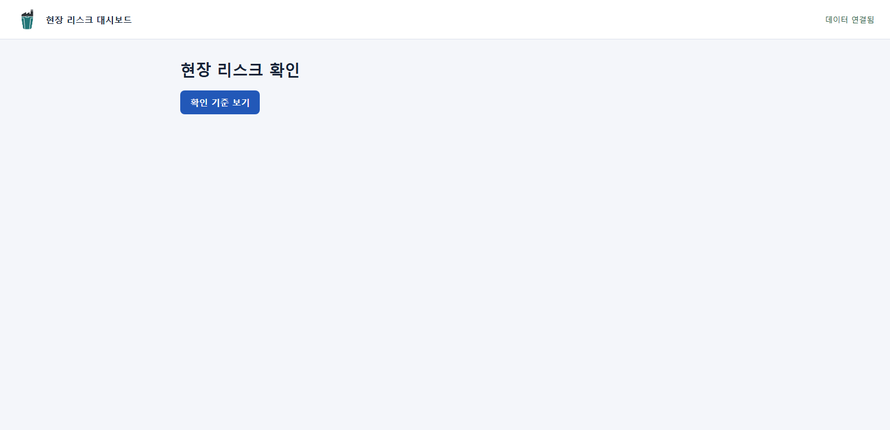
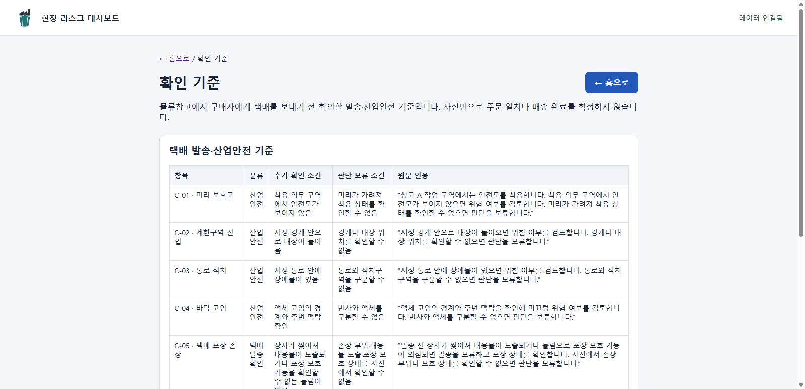
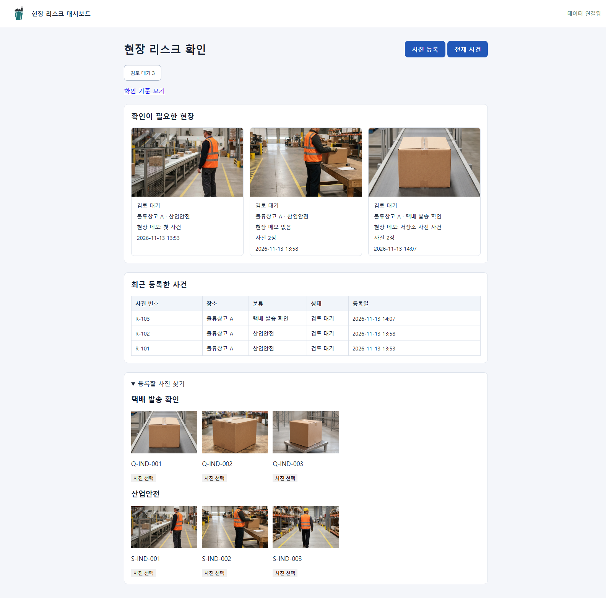
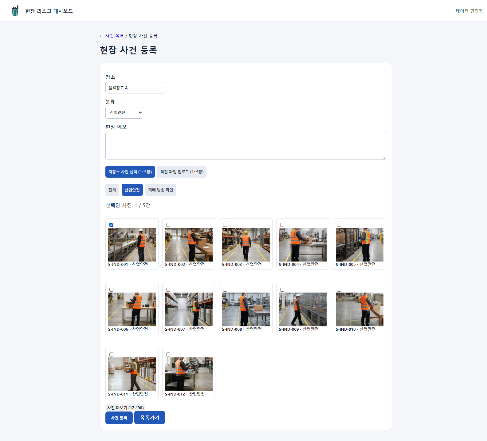
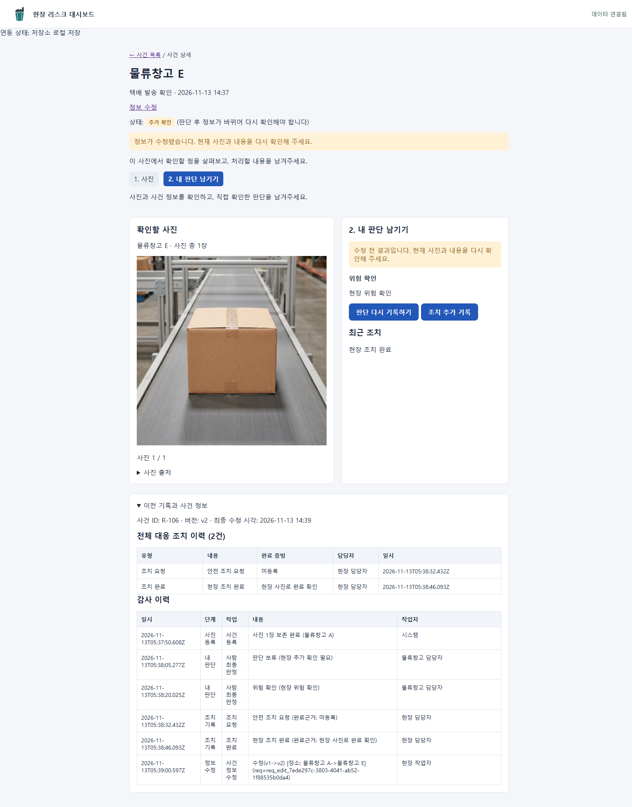
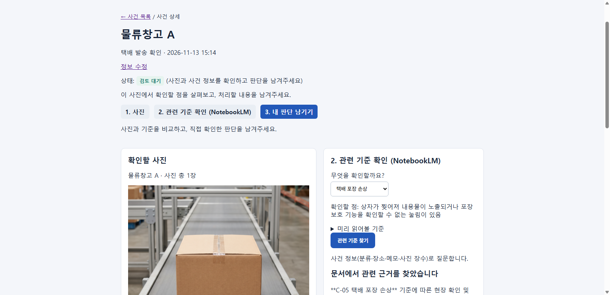
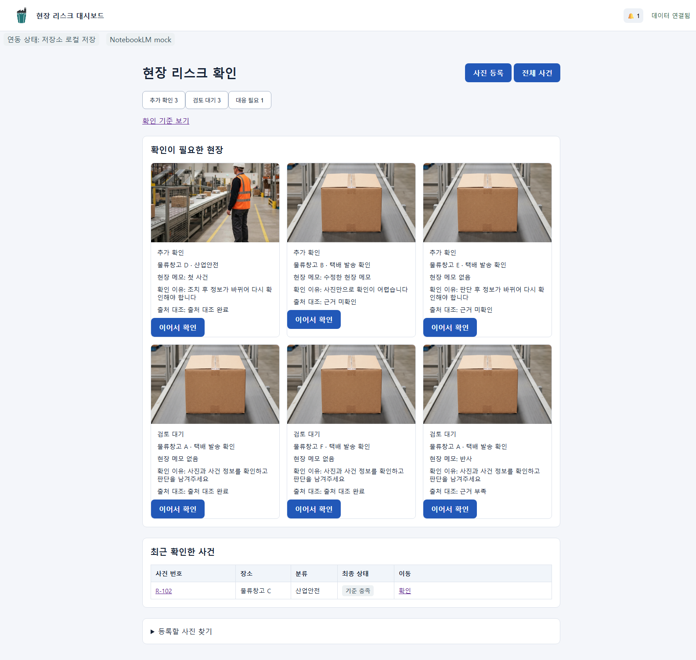
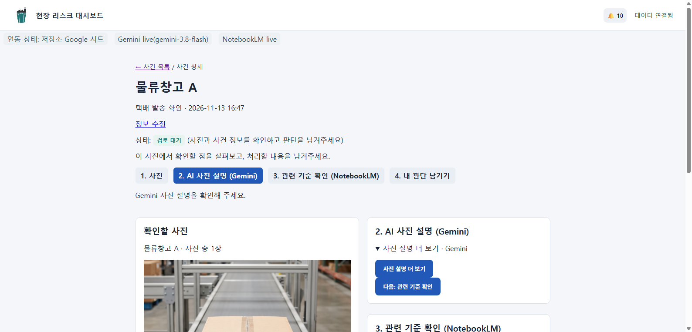
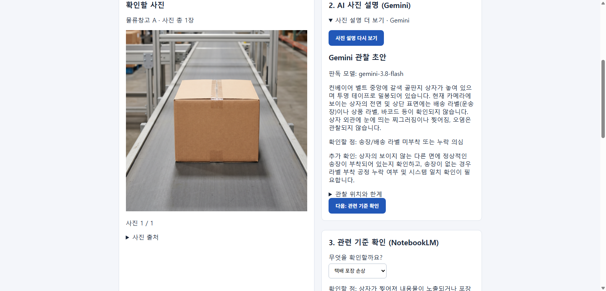

# 따라하기 프롬프트

각 회차를 순서대로 진행합니다. 같은 프로젝트 폴더에서 코드 블록을 하나씩 AI에게 보내세요. 결과를 확인한 뒤 다음 프롬프트로 넘어갑니다.

## 1회차: 현장 리스크 대시보드 시작하기

### 완성 예시

아래 화면은 참고용입니다. AI가 만든 화면은 다를 수 있습니다.





### 준비
빈 작업 폴더를 만들고 AI 도구에서 엽니다. 다음 프롬프트를 보냅니다.

```text
이 폴더에서 웹 서비스를 만들 수 있게 Node.js와 Git이 설치되어 있는지 확인해줘. 없으면 설치 방법을 알려줘. 설치나 로그인 중 내가 직접 해야 하는 일이 있으면 멈추고 알려줘.
```

### 수업 자료 받기

```text
https://github.com/startup-life/vision-risk-dashboard-student 저장소에서 materials 폴더만 이 프로젝트에 가져와줘. 확인 기준과 로고를 수업에서 사용할 거야. 자료를 받지 못하면 이유를 알려줘.
```

### 화면 만들기

```text
물류창고의 택배 발송과 산업안전 사진을 확인하는 '현장 리스크 대시보드'를 만들어줘. Node.js 서버와 HTML, CSS, JavaScript를 사용하고 내 컴퓨터에서 실행해줘.

홈 화면에 서비스 이름과 '확인 기준 보기' 버튼을 만들어줘. 버튼을 누르면 확인 기준 화면이 열리고 홈으로 돌아올 수 있게 해줘.
```

```text
materials/standards.json의 확인 기준을 확인 기준 화면에 표로 보여줘. 기준의 내용과 수업용 가상 기준이라는 안내를 바꾸지 말아줘.
```

```text
화면에 서버 연결 상태와 오류 안내를 표시해줘. 컴퓨터와 휴대폰 크기에서 보기 편하게 정리해줘. 서버를 다시 켜는 방법도 알려줘.
```

### 직접 확인
- AI가 알려준 주소를 브라우저에서 열고 홈과 확인 기준 화면을 오가 봅니다.
- 서버를 멈췄을 때 연결 오류가 표시되는지 확인합니다.
- 같은 프로젝트 폴더를 다음 회차에도 사용합니다.

---

## 2회차: 사진으로 사건 등록하기

### 완성 예시

아래 화면은 참고용입니다. AI가 만든 화면은 다를 수 있습니다.





### 준비
1회차에 만든 프로젝트 폴더를 AI 도구에서 엽니다. 서버가 꺼져 있다면 켜 달라고 요청합니다.

### 사건 등록과 저장

```text
현장 리스크 대시보드에 사건 등록 화면을 만들어줘. 장소, 분류(택배 발송 또는 산업안전), 현장 메모와 사진을 입력하게 해줘. 한 사건에 사진은 1~5장까지 선택하고 잘못된 파일이나 너무 큰 파일은 이유를 알려줘.
```

```text
등록한 사건과 사진을 내 컴퓨터에 저장하고 목록에서 다시 볼 수 있게 해줘. 서버를 껐다 켜도 기록이 남아야 해. 저장에 실패하면 입력한 내용은 유지하고 이유를 알려줘.
```

```text
홈에 확인이 필요한 사건을 사진 카드로 보여주고, 전체 사건 목록으로 이동하는 버튼을 만들어줘. 목록에는 장소, 분류, 등록 시각과 상태를 표시해줘.
```

### 연습 사진 사용하기

```text
수업용 사진 저장소 https://github.com/startup-life/vision-risk-student-images 를 프로젝트 옆에 내려받고, 등록 화면에서 사진을 보고 선택할 수 있게 해줘. 내 컴퓨터의 사진을 직접 올리는 방법도 유지해줘. 사진 저장소를 받지 못하면 이유를 알려주고 직접 올리기는 계속 사용할 수 있게 해줘.
```

### 직접 확인
- 택배 발송 사건 하나와 산업안전 사건 하나를 등록합니다.
- 목록에서 사진과 장소가 맞는지 확인합니다.
- 서버를 다시 켠 뒤에도 두 사건이 남아 있는지 확인합니다.

---

## 3회차: 판단과 조치 기록하기

### 완성 예시

아래 화면은 참고용입니다. AI가 만든 화면은 다를 수 있습니다.




### 준비
2회차 프로젝트를 열고 서버를 켭니다. 이전에 등록한 사건이 보이는지 확인합니다.

### 상세 화면

```text
사건 목록에서 사건을 선택하면 사진, 장소, 분류, 메모와 등록 시각을 자세히 볼 수 있게 해줘. 사진이 여러 장이면 하나씩 바꿔 볼 수 있게 해줘.
```

```text
사건의 장소와 메모를 수정할 수 있게 해줘. 수정한 시각과 변경 내용을 이력으로 남겨줘.
```

### 사람의 판단과 조치

```text
사건 상세 화면에 사람이 직접 판단을 기록하는 기능을 만들어줘. 판단은 '위험 확인', '기준 충족', '판단 보류', '해당 없음' 중에서 고르고 이유를 적게 해줘. AI가 자동으로 최종 판단하지 않는다는 안내도 표시해줘.
```

```text
위험을 확인한 사건에 조치 내용과 완료 여부를 기록하게 해줘. 판단과 조치 이력을 다시 볼 수 있게 하고, 아직 확인하지 않은 사건과 조치가 필요한 사건을 홈에서 구분해줘. 판단 뒤 사건 정보가 바뀌면 다시 확인하라고 알려줘.
```

### 직접 확인
- 사건을 열어 정보를 수정하고 변경 이력을 확인합니다.
- 위험 확인과 조치 내용을 기록한 뒤 서버를 다시 켜도 남아 있는지 확인합니다.
- 정보를 다시 수정했을 때 재확인 안내가 보이는지 살펴봅니다.

---

## 4회차: NotebookLM으로 관련 기준 찾기

### 완성 예시

아래 화면은 참고용입니다. AI가 만든 화면은 다를 수 있습니다.





### 준비
3회차 프로젝트와 브라우저를 엽니다. Google 계정 로그인이 필요할 수 있습니다.

### 수업용 기준 준비

```text
materials/factory-criteria-v1.txt 파일을 열어줘. 이 문서를 NotebookLM에 올려 수업용 기준으로 사용할 거야.
```

```text
내가 준비한 기준 문서를 NotebookLM에 올리고 노트북을 만드는 방법을 단계별로 알려줘. 로그인이 필요하면 내가 직접 할게. 노트북이 준비되면 내게 확인받아줘.
```

### 관련 기준 확인

```text
사건 상세 화면에 사진을 보고 관찰 내용을 직접 적는 칸과 '관련 기준 찾기' 버튼을 추가해줘. 관찰 내용과 현장 메모로 NotebookLM에 질문하고, 답변과 출처를 표시하도록 연결해줘. 먼저 연결이 안 된 상태에서도 화면을 연습할 수 있게 예시 결과를 제공하고 '연습용'이라고 표시해줘.
```

```text
NotebookLM 연결에 필요한 설치와 설정을 도와줘. 로그인이나 권한 승인은 내가 직접 할게. 실제 연결이 되면 예시 결과와 구분해서 표시하고, 실패하면 실제 결과인 것처럼 보이지 않게 오류를 알려줘.
```

### 직접 확인
- 연습용 결과에 연습용 표시가 있는지 확인합니다.
- 실제 연결 후 사건에서 기준을 찾아 출처를 열어 보고 문서와 맞는지 확인합니다.
- 연결이 어렵다면 오류를 강사와 확인하고 연습용으로 계속합니다. 최종 판단은 직접 기록합니다.

---

## 5회차: Gemini 사진 설명과 Google 저장소

### 완성 예시

아래 화면은 참고용입니다. AI가 만든 화면은 다를 수 있습니다.





### 준비
4회차 프로젝트를 엽니다. 수업에서 안내한 OnePort API 키와 Google 계정을 준비합니다. 키를 공개 저장소에 올리거나 화면에 표시하지 않습니다.

### 사진 설명

```text
사건 상세 화면에 'AI 사진 설명' 버튼을 추가해줘. materials/gemini-prompt.txt를 참고해 Gemini가 사진에서 보이는 내용을 설명하고, 결과는 사람이 확인할 참고 자료라고 표시해줘. 사진에서 확인할 수 없는 사실은 추측하지 않게 해줘.
```

```text
실제 연결 전에는 연습용 사진 설명을 보여주고 연습용이라고 표시해줘. OnePort를 통해 Gemini에 연결할 준비를 하고, 키는 Git에 올라가지 않는 설정 파일에 저장하게 해줘. 연결 실패는 오류로 표시하고 연습용 결과를 실제 결과로 보이게 하지 마.
```

### Google 시트와 Drive 연결

```text
사건 기록과 판단·조치는 내 Google 시트에, 사건 사진은 내 Google Drive에 저장할 수 있게 Google Apps Script를 이용해 연결해줘. 기존 내 컴퓨터 저장 방식도 연습용으로 유지하고 현재 어떤 저장소를 쓰는지 화면에 표시해줘.
```

```text
Google Apps Script 프로젝트를 만들고 배포하는 과정을 도와줘. 필요한 로그인과 권한 승인은 내가 직접 할게. 이미 만든 프로젝트나 배포가 있으면 먼저 확인하고 중복 생성하지 마. 접근 권한과 공개 범위를 설명하고 내가 확인한 뒤 진행해줘.
```

```text
수업에서 받은 OnePort 키를 내가 직접 설정 파일에 넣는 방법을 알려줘. 키 값은 출력하거나 커밋하지 말고, 설정을 마친 뒤 실제 사진 설명과 시트·Drive 저장이 되는지 확인해줘.
```

### 직접 확인
- 수업용 사진을 등록하고 AI 설명이 실제 응답인지 확인합니다.
- Google 시트에 기록, Drive에 사진이 저장됐는지 확인합니다.
- 사진 설명이 맞는지 살펴보고 관련 기준을 확인한 뒤 직접 판단을 남깁니다.
- 연결이 안 되면 오류를 확인하고 연습용으로 계속합니다.

---

## 6회차: 사진 분류 모델 만들기

### 완성 예시

아래 화면은 참고용입니다. AI가 만든 화면은 다를 수 있습니다.


### 준비
5회차 프로젝트와 수업용 사진을 준비합니다. Google 연결이 되지 않아도 로컬 연습으로 진행할 수 있습니다.

### 모델 학습

```text
현장 리스크 대시보드에 사진 분류 모델을 학습하는 화면을 추가해줘. 택배 발송과 산업안전 모델을 따로 만들고, 수업용 사진을 사람이 직접 유형별로 분류해 학습용과 검증용으로 나눌 수 있게 해줘. 정답이 주어진 것처럼 표시하지 마.
```

```text
Teachable Machine 방식으로 브라우저에서 사진 분류 모델을 학습하고, 검증용 사진으로 결과를 확인하게 해줘. 유형별 사진이 부족하면 학습 전에 알려줘. 학습한 모델을 내 컴퓨터에 저장하고 다시 불러올 수 있게 해줘.
```

```text
학습 결과에서 유형별 예측과 정확도를 보여주고, 결과가 내가 분류한 검증 사진에 따라 달라진다고 설명해줘. 여러 모델을 비교하고 사건 확인에 사용할 모델을 선택하게 해줘.
```

### 사건에 적용

```text
사건 상세 화면에서 선택한 모델로 사진을 분류하고 예측 유형과 점수를 보여줘. 모델이 없으면 학습 화면으로 안내해줘. 예측은 참고 자료이며 안전 판정이나 출하 승인으로 쓰지 않는다고 표시해줘.
```

```text
사진 설명, 모델 예측, 관련 기준과 내 판단을 사건 상세에서 순서대로 확인하게 해줘. AI 연결이 실패하거나 모델이 없어도 사람이 판단을 기록할 수 있게 해줘.
```

### 직접 확인
- 사진을 직접 분류해 택배 발송 모델을 학습하고 검증합니다. 산업안전 모델도 같은 방법으로 만들어 봅니다.
- 사건 두 개에서 예측을 확인하고 관련 기준을 살펴본 뒤 판단과 조치를 기록합니다.
- 서버를 다시 켜도 사건 기록과 저장한 모델을 다시 사용할 수 있는지 확인합니다.
