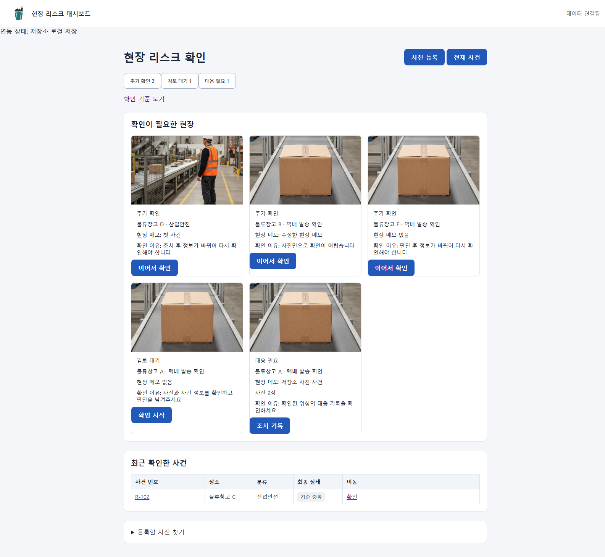
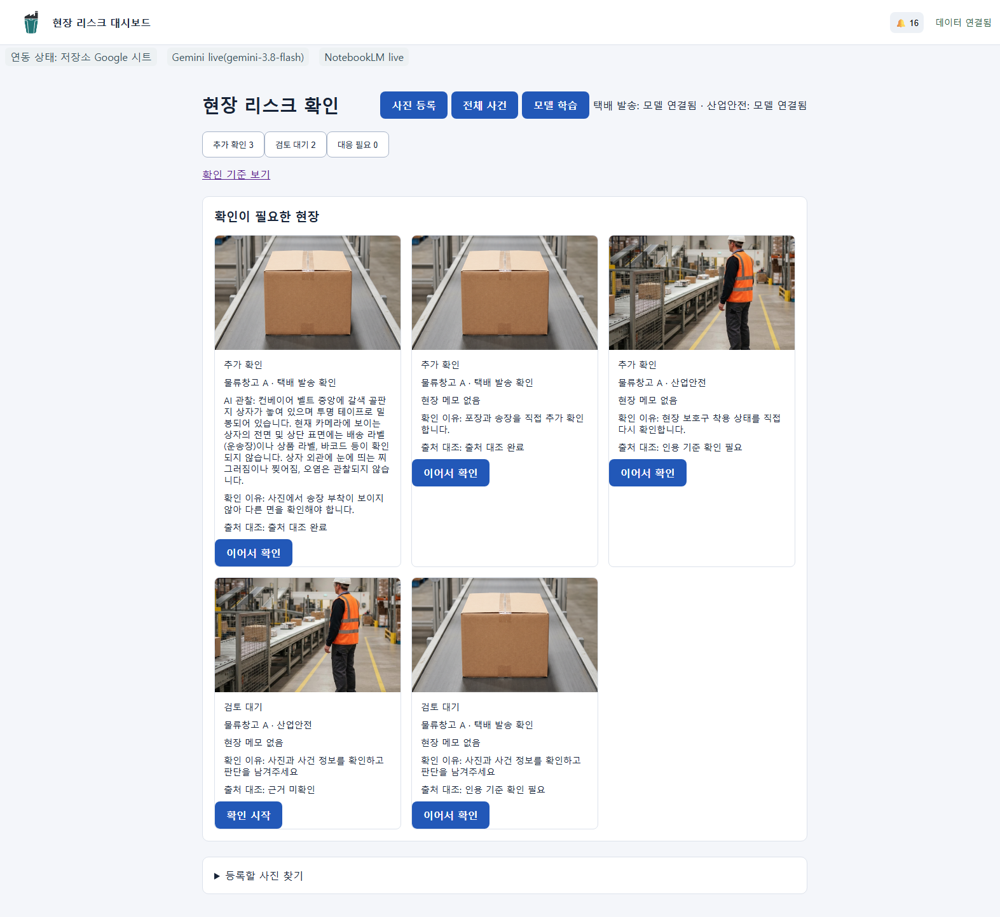
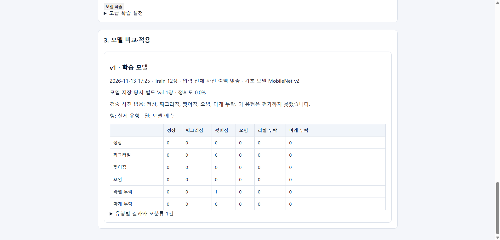

# 따라하기 프롬프트

각 회차를 순서대로 진행합니다. 같은 프로젝트 폴더에서 코드 블록을 하나씩 AI에게 보내세요. 결과를 확인한 뒤 다음 프롬프트로 넘어갑니다.

## 1회차: 현장 리스크 대시보드 시작하기

### 완성 예시

아래 화면은 참고용입니다. AI가 만든 화면은 다를 수 있습니다.


### 준비
빈 작업 폴더를 만들고 AI 도구에서 엽니다. 다음 프롬프트를 보냅니다.

```text
새 폴더에서 시작해줘. Node.js와 Git을 확인하고 없으면 설치 방법을 알려줘. 웹사이트는 여기서 만드는 파일과 내가 지정한 자료만 사용해줘.
```

### 수업 자료 받기

```text
https://github.com/startup-life/vision-risk-dashboard-student 의 materials 폴더에서 standards.json, factory-criteria-v1.txt, gemini-prompt.txt, factory-logo.png만 같은 경로에 받아줘. 실패하면 이유를 알려줘.
```

### 화면 만들기

```text
택배 발송과 산업안전 사진을 확인하는 ‘현장 리스크 대시보드’를 만들어 실행해줘. Node.js와 HTML·CSS·JavaScript를 써줘. 홈의 ‘확인 기준 보기’ 버튼으로 기준 화면을 열고 돌아오게 해줘.
```

```text
materials/standards.json의 기준을 표로 보여줘. 기준 원문과 ‘수업용 가상 기준’ 안내를 유지해줘.
```

```text
PC와 휴대폰에서 화면을 확인해줘. 서버 연결 상태와 오류를 표시하고 다시 실행하는 방법을 알려줘.
```

### 직접 확인
- AI가 알려준 주소를 브라우저에서 열고 홈과 확인 기준 화면을 오가 봅니다.
- 서버를 멈췄을 때 연결 오류가 표시되는지 확인합니다.
- 같은 프로젝트 폴더를 다음 회차에도 사용합니다.

---

## 2회차: 사진으로 사건 등록하기

### 완성 예시

아래 화면은 참고용입니다. AI가 만든 화면은 다를 수 있습니다.


### 준비
1회차에 만든 프로젝트 폴더를 AI 도구에서 엽니다. 서버가 꺼져 있다면 켜 달라고 요청합니다.

### 사건 등록과 저장

```text
사건 등록 화면에 장소, 분류(택배 발송·산업안전), 메모, 사진 1~5장을 입력하게 해줘. 파일 형식이나 크기가 맞지 않으면 이유를 보여줘.
```

```text
사건과 사진을 내 컴퓨터에 저장해줘. 서버를 다시 켜도 목록에 남고, 저장에 실패하면 입력값과 실패 이유가 보이게 해줘.
```

```text
홈에는 확인할 사건을 사진 카드로 보여줘. 전체 목록에서는 장소·분류·등록 시각·상태를 확인하게 해줘.
```

### 연습 사진 사용하기

```text
https://github.com/startup-life/vision-risk-student-images 의 사진 ZIP을 assets/vision-photos에 풀고 등록 화면에서 보고 고르게 해줘. 다운로드에 실패하면 이유를 보여줘. 내 사진도 직접 올릴 수 있게 해줘.
```

### 직접 확인
- 택배 발송 사건 하나와 산업안전 사건 하나를 등록합니다.
- 목록에서 사진과 장소가 맞는지 확인합니다.
- 서버를 다시 켠 뒤에도 두 사건이 남아 있는지 확인합니다.

---

## 3회차: 판단과 조치 기록하기

### 완성 예시

아래 화면은 참고용입니다. AI가 만든 화면은 다를 수 있습니다.




### 준비
2회차 프로젝트를 열고 서버를 켭니다. 이전에 등록한 사건이 보이는지 확인합니다.

### 상세 화면

```text
목록에서 사건을 열면 장소·분류·메모·등록 시각이 보이게 해줘. 사진이 여러 장이면 넘겨 볼 수 있게 해줘.
```

```text
사건의 장소와 메모를 수정하고, 바뀐 내용과 시각을 이력에 남겨줘.
```

### 사람의 판단과 조치

```text
사건 상세에서 사람이 ‘위험 확인·기준 충족·판단 보류·해당 없음’ 중 하나를 고르고 이유를 쓰게 해줘. 최종 판단은 사람이 한다고 표시해줘.
```

```text
위험을 확인하면 조치 내용과 완료 여부를 기록해줘. 상세에는 판단·조치 이력을, 홈에는 미확인 사건과 조치할 사건을 나눠 보여줘. 판단 뒤 사건이 바뀌면 재확인을 안내해줘.
```

### 직접 확인
- 사건을 열어 정보를 수정하고 변경 이력을 확인합니다.
- 위험 확인과 조치 내용을 기록한 뒤 서버를 다시 켜도 남아 있는지 확인합니다.
- 정보를 다시 수정했을 때 재확인 안내가 보이는지 살펴봅니다.

---

## 4회차: NotebookLM으로 관련 기준 찾기

### 완성 예시

아래 화면은 참고용입니다. AI가 만든 화면은 다를 수 있습니다.


### 준비
3회차 프로젝트와 브라우저를 엽니다. Google 계정 로그인이 필요할 수 있습니다.

### 수업용 기준 준비

```text
materials/factory-criteria-v1.txt를 열어 NotebookLM에 올릴 기준 원문을 보여줘.
```

```text
그 파일로 NotebookLM 노트북을 만드는 방법을 알려줘. 로그인은 내가 할게. 노트북을 만들면 연결에 쓸 노트북 ID를 어디서 찾는지 보여줘.
```

### 관련 기준 확인

```text
사건 상세에 관찰 메모와 ‘관련 기준 찾기’ 버튼을 만들어줘. 관찰 내용과 현장 메모로 질문하게 해줘. 연결 전에는 ‘연습용’ 답변을 보여줘.
```

```text
서버에서 NotebookLM 연결 도구인 nlm(제3자 CLI)을 사용해줘. 설치를 안내하고 로그인은 내게 맡겨줘. 연결한 노트북에 실제로 질문해 인용 번호와 근거 문장을 보여줘. 실패하면 오류를 표시해줘.
```

### 직접 확인
- 연습용 결과에 연습용 표시가 있는지 확인합니다.
- 실제 연결 후 사건에서 기준을 찾아 출처를 열어 보고 문서와 맞는지 확인합니다.
- 연결이 어렵다면 오류를 강사와 확인하고 연습용으로 계속합니다. 최종 판단은 직접 기록합니다.

---

## 5회차: Gemini 사진 설명과 Google 저장소

### 완성 예시

아래 화면은 참고용입니다. AI가 만든 화면은 다를 수 있습니다.


### 준비
4회차 프로젝트를 엽니다. 수업에서 안내한 OnePort API 키와 Google 계정을 준비합니다. 키를 공개 저장소에 올리거나 화면에 표시하지 않습니다.

### 사진 설명

```text
사건에서 고른 사진에 ‘AI 사진 설명’ 버튼을 붙여줘. materials/gemini-prompt.txt로 보이는 것만 설명하고 사람이 확인할 참고 자료라고 표시해줘.
```

```text
연습용 설명에 ‘연습용’을 표시해줘. 실제 설명은 서버에서 OnePort(https://oneport.kr/v1)의 gemini-3.8-flash를 호출하고, 실패하면 오류를 보여줘.
```

### Google 시트와 Drive 연결

```text
사건·판단·조치는 Google 시트에, 사진은 Drive에 저장하는 Apps Script를 만들어줘. 기존 로컬 저장도 유지하고 현재 저장 위치를 표시해줘.
```

```text
이 실습의 Apps Script 프로젝트와 배포가 있는지 먼저 확인해줘. 누가 접근할 수 있는지 설명하고 내가 확인하면 배포해줘. 로그인과 권한 승인은 내가 할게.
```

```text
OnePort 키는 내가 서버 비공개 설정에 입력할게. 화면·로그·Git에 키를 남기지 마. 수업 사진으로 실제 설명을 받고, Google에서 사건·판단·조치와 사진을 다시 불러와 확인해줘.
```

### 직접 확인
- 수업용 사진을 등록하고 AI 설명이 실제 응답인지 확인합니다.
- Google 시트에 기록, Drive에 사진이 저장됐는지 확인합니다.
- 사진 설명이 맞는지 살펴보고 관련 기준을 확인한 뒤 직접 판단을 남깁니다.
- 연결이 안 되면 오류를 확인하고 연습용으로 계속합니다.

---

## 6회차: 사진 분류 모델 만들기

### 완성 예시

아래 화면은 참고용입니다. AI가 만든 화면은 다를 수 있습니다.





### 준비
5회차 프로젝트와 수업용 사진을 준비합니다. Google 연결이 되지 않아도 로컬 연습으로 진행할 수 있습니다.

### 모델 학습

```text
택배 발송과 산업안전 모델을 따로 학습하는 화면을 만들어줘. 모든 사진은 미분류로 시작해. 사람이 사진 유형과 용도(학습용·검증용)를 직접 고르게 해줘.
```

```text
브라우저에서 사전학습된 MobileNet으로 사진 특징을 뽑아 분류층을 학습해줘. 유형별 사진이 부족하면 알려줘. 정확도는 따로 둔 검증 사진의 실제 예측으로 계산하고 모델 파일을 저장·불러오게 해줘.
```

```text
유형별 예측과 정확도를 보여줘. 내가 분류한 검증 사진에 따라 점수가 달라진다고 알려줘. 모델을 비교하고 사건에 쓸 모델을 고르게 해줘.
```

### 사건에 적용

```text
사건 사진에 선택한 모델을 적용해 예측 유형과 점수를 보여줘. 모델이 없으면 학습 화면으로 안내해줘. 예측은 참고용이며 안전 판정과 출하 승인은 사람이 한다고 표시해줘.
```

```text
사건 하나를 열어 사진 설명 → 모델 예측 → 관련 기준 → 사람 판단 순서로 확인해줘. AI가 끊기거나 모델이 없어도 내 판단을 저장할 수 있는지 시험해줘.
```

### 직접 확인
- 사진을 직접 분류해 택배 발송 모델을 학습하고 검증합니다. 산업안전 모델도 같은 방법으로 만들어 봅니다.
- 사건 두 개에서 예측을 확인하고 관련 기준을 살펴본 뒤 판단과 조치를 기록합니다.
- 서버를 다시 켜도 사건 기록과 저장한 모델을 다시 사용할 수 있는지 확인합니다.
