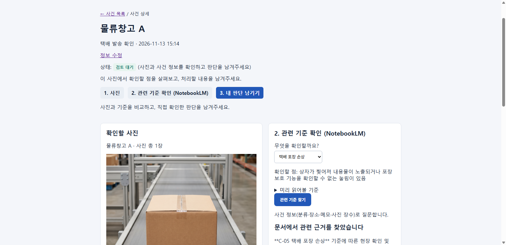
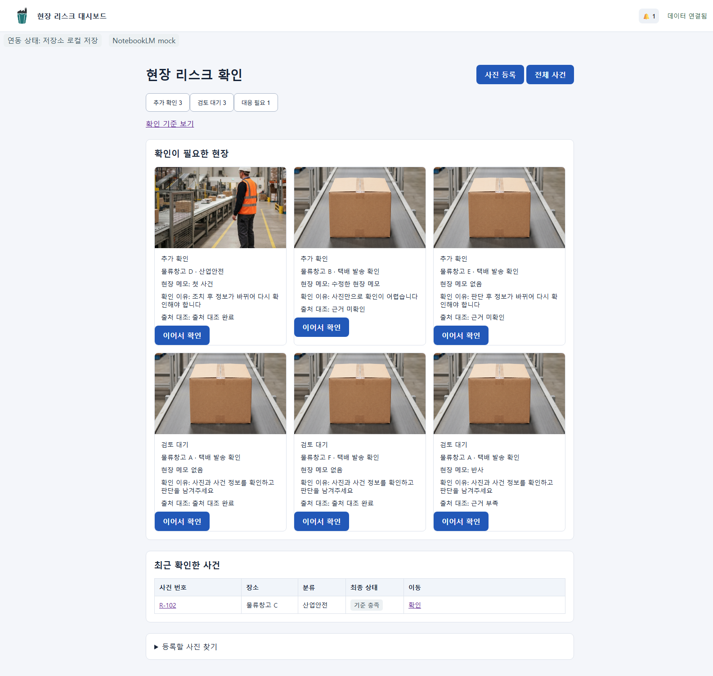

# 4회차: NotebookLM으로 관련 기준 찾기

> **진행 방법**: AI 도구에서 같은 프로젝트 폴더를 열고 아래 프롬프트를 한 번에 하나씩 보냅니다. AI가 끝내면 확인 항목을 직접 살펴보고 다음으로 넘어갑니다. 오류가 나면 오류 문구를 그대로 보내 해결을 요청하세요. 결과 화면은 예시와 조금 달라도 됩니다.
>
> 실제 현장 데이터 대신 수업용 사진과 가상 데이터를 사용합니다. AI의 결과는 참고이며 최종 판단은 사람이 합니다.

## 완성 예시

아래 화면은 참고용입니다. AI가 만든 화면은 다를 수 있습니다.





## 준비
3회차 프로젝트와 브라우저를 엽니다. Google 계정 로그인이 필요할 수 있습니다.

## 수업용 기준 준비

```text
materials/factory-criteria-v1.txt 파일을 열어줘. 이 문서를 NotebookLM에 올려 수업용 기준으로 사용할 거야.
```

```text
내가 준비한 기준 문서를 NotebookLM에 올리고 노트북을 만드는 방법을 단계별로 알려줘. 로그인이 필요하면 내가 직접 할게. 노트북이 준비되면 내게 확인받아줘.
```

## 관련 기준 확인

```text
사건 상세 화면에 사진을 보고 관찰 내용을 직접 적는 칸과 '관련 기준 찾기' 버튼을 추가해줘. 관찰 내용과 현장 메모로 NotebookLM에 질문하고, 답변과 출처를 표시하도록 연결해줘. 먼저 연결이 안 된 상태에서도 화면을 연습할 수 있게 예시 결과를 제공하고 '연습용'이라고 표시해줘.
```

```text
NotebookLM 연결에 필요한 설치와 설정을 도와줘. 로그인이나 권한 승인은 내가 직접 할게. 실제 연결이 되면 예시 결과와 구분해서 표시하고, 실패하면 실제 결과인 것처럼 보이지 않게 오류를 알려줘.
```

## 직접 확인
- 연습용 결과에 연습용 표시가 있는지 확인합니다.
- 실제 연결 후 사건에서 기준을 찾아 출처를 열어 보고 문서와 맞는지 확인합니다.
- 연결이 어렵다면 오류를 강사와 확인하고 연습용으로 계속합니다. 최종 판단은 직접 기록합니다.
