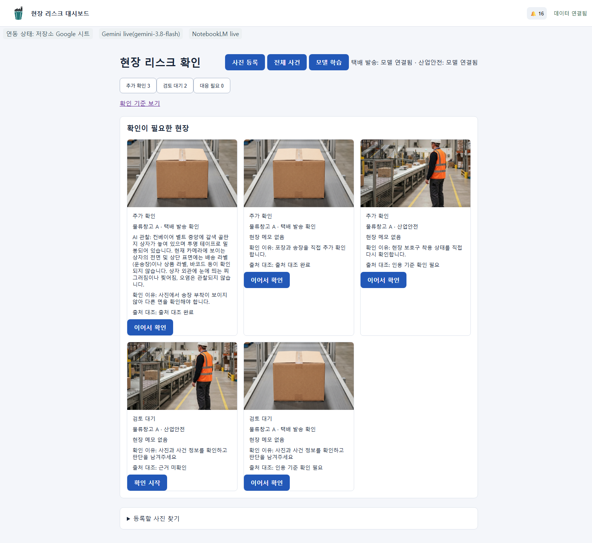
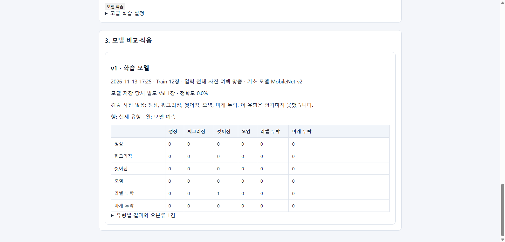

# 6회차: 사진 분류 모델 만들기

> **진행 방법**: AI 도구에서 같은 프로젝트 폴더를 열고 아래 프롬프트를 한 번에 하나씩 보냅니다. AI가 끝내면 확인 항목을 직접 살펴보고 다음으로 넘어갑니다. 오류가 나면 오류 문구를 그대로 보내 해결을 요청하세요. 결과 화면은 예시와 조금 달라도 됩니다.
>
> 실제 현장 데이터 대신 수업용 사진과 가상 데이터를 사용합니다. AI의 결과는 참고이며 최종 판단은 사람이 합니다.

## 완성 예시

아래 화면은 참고용입니다. AI가 만든 화면은 다를 수 있습니다.





## 준비
5회차 프로젝트와 수업용 사진을 준비합니다. Google 연결이 되지 않아도 로컬 연습으로 진행할 수 있습니다.

## 모델 학습

```text
현장 리스크 대시보드에 사진 분류 모델을 학습하는 화면을 추가해줘. 택배 발송과 산업안전 모델을 따로 만들고, 수업용 사진을 사람이 직접 유형별로 분류해 학습용과 검증용으로 나눌 수 있게 해줘. 정답이 주어진 것처럼 표시하지 마.
```

```text
Teachable Machine 방식으로 브라우저에서 사진 분류 모델을 학습하고, 검증용 사진으로 결과를 확인하게 해줘. 유형별 사진이 부족하면 학습 전에 알려줘. 학습한 모델을 내 컴퓨터에 저장하고 다시 불러올 수 있게 해줘.
```

```text
학습 결과에서 유형별 예측과 정확도를 보여주고, 결과가 내가 분류한 검증 사진에 따라 달라진다고 설명해줘. 여러 모델을 비교하고 사건 확인에 사용할 모델을 선택하게 해줘.
```

## 사건에 적용

```text
사건 상세 화면에서 선택한 모델로 사진을 분류하고 예측 유형과 점수를 보여줘. 모델이 없으면 학습 화면으로 안내해줘. 예측은 참고 자료이며 안전 판정이나 출하 승인으로 쓰지 않는다고 표시해줘.
```

```text
사진 설명, 모델 예측, 관련 기준과 내 판단을 사건 상세에서 순서대로 확인하게 해줘. AI 연결이 실패하거나 모델이 없어도 사람이 판단을 기록할 수 있게 해줘.
```

## 직접 확인
- 사진을 직접 분류해 택배 발송 모델을 학습하고 검증합니다. 산업안전 모델도 같은 방법으로 만들어 봅니다.
- 사건 두 개에서 예측을 확인하고 관련 기준을 살펴본 뒤 판단과 조치를 기록합니다.
- 서버를 다시 켜도 사건 기록과 저장한 모델을 다시 사용할 수 있는지 확인합니다.
